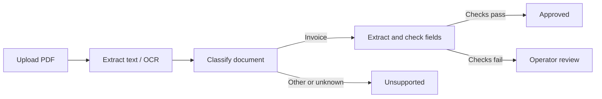

# AI Document Processing Platform

A local demonstration of extracting structured data from PDF invoices,
checking it with automatic rules and sending invoices that fail those checks
to a human reviewer. An optional local AI model can suggest values; an operator
chooses whether to adopt them.

The React console is for operators uploading documents, inspecting results and
reviewing invoices. Engineers can investigate failed runs and request
reprocessing. Use synthetic documents only. See the
[product overview](docs/product-overview.md) for the full scope.

## How it works

The API validates and stores a PDF, then records a request to start processing.
A separate dispatcher starts a Temporal workflow. The worker extracts embedded
text with PyMuPDF and uses Tesseract OCR when that text is insufficient. It
classifies the document and extracts supported invoice fields.



The fields are invoice number, issue date, supplier, currency and total. The
rules check required values and a positive total. The console shows the source
PDF beside correction fields during review. An operator can correct and approve
the invoice, or reject it.

For example, the supplied scanned invoice has no issue date. OCR makes its text
readable, but the missing date sends it to review. The operator can inspect the
PDF and reject it or leave it pending; inventing a date would not resolve the
missing information. The optional model proposal never changes the original
extraction or approves a document.

## Local demo

The complete demo needs Docker with the Compose plugin, Kind, `kubectl` and
`uv`. From the repository root:

```bash
cp .env.example .env
openssl rand -hex 32
# Put the generated value in .env as DOCUMENT_PLATFORM_REVIEW_OPERATOR_TOKEN.
uv sync --all-groups
uv run --no-sync python scripts/parser_runtime.py up
```

The supervisor starts the disposable Kind/Calico parser runtime and the Compose
stack, then cleans up the runtime and credentials when stopped with Ctrl-C.
Compose data volumes remain. Open
[http://localhost:8088](http://localhost:8088). Upload one of the supplied
[synthetic PDFs](examples/documents/README.md):

| File | Expected result |
| --- | --- |
| `invoice-digital.pdf` | Review required; its CAD total is outside the deterministic extractor's supported currency formats. |
| `invoice-scanned.pdf` | OCR followed by review because the issue date is missing. |
| `equipment-report.pdf` | Unsupported document, without an invoice review form. |

To open the Documents workspace, enter the value of
`DOCUMENT_PLATFORM_REVIEW_OPERATOR_TOKEN` from `.env`. This shared token is a
development fixture. The demo binds published ports to `127.0.0.1` and uses
development credentials.

Ollama is disabled by default. To try advisory proposals, run the configured
model on the host and follow the [local-model setup](docs/local-demo.md#optional-local-model).
The [demo and operations guide](docs/local-demo.md) also covers host development,
Temporal, port overrides, metrics, retention and failure demonstrations.
Stop the supervised session with Ctrl-C. The supervisor stops its Compose
services, removes its disposable Kind cluster and credentials, and retains the
Compose data volumes. For a stack started directly with Compose, use
`docker compose down` without `-v` to retain its named volumes.

## Main capabilities

- PDF byte limits, asynchronous structural validation, idempotent uploads and
  content-addressed local storage.
- Durable workflow handoff, bounded processing retries and reuse of persisted
  stage results.
- Embedded-text extraction, OCR fallback, document classification and
  deterministic invoice extraction and validation.
- Work queues, on-demand source-PDF preview, typed field corrections and
  approval or rejection through the console.
- Optional Ollama proposals with recorded provenance, separate AI execution
  status and explicit operator adoption of individual values.
- Controlled reprocessing with preserved previous results, recorded review
  decisions and database retention with a dry-run default.
- Prometheus metrics, JSON logs, HTTP correlation, an optional Grafana dashboard
  and a static interactive architecture map.

The [capability table](docs/product-overview.md#capability-status) records the
implemented and planned boundaries. The latest tagged release is `v1.2.0`;
its [release notes](docs/releases/v1.2.0.md) record the local-security work and
verification. Development now targets v1.3.0: Python metadata and build metrics
report `1.3.0.dev0`; the API contract and operator console report `1.3.0-dev.0`.
The [v1.3.0 scope](docs/releases/v1.3.0.md) documents the implemented local
per-document PDF parser containment flow and its verification. Resource limits
remain provisional; remote deployment and stronger kernel isolation are outside
the supported scope.

## Limits

Structured extraction supports invoices with explicitly labelled fields.
The deterministic total parser recognizes EUR, USD and GBP formats; review
corrections and model proposals validate currency codes against ISO 4217.
Purchase orders, credit notes and unrecognized documents are classified but
finish as `UNSUPPORTED`. The synthetic evaluation corpus does not establish
accuracy on real invoices.

Every document API route requires one shared local bearer token. Health,
metrics and OpenAPI remain unauthenticated within the loopback boundary. The
token does not provide per-user or tenant isolation. Extracted text is stored
internally in PostgreSQL; status and queue APIs exclude it. Database retention
does not delete PDF blobs.

The v1.1 API image scan found HIGH/CRITICAL OS-package vulnerabilities. Their
risk is accepted only for the local synthetic-data demo; the API image is not a
release artifact. Public exposure, confidential documents, hostile PDFs and
production deployment remain outside the supported scope. See
[security and limitations](docs/security-and-limitations.md) for the controls,
recorded findings and remaining work.

## Technologies

Python 3.13, FastAPI and PostgreSQL for the backend; PyMuPDF and Tesseract for
PDF text and OCR; Temporal for workflow execution; optional Ollama for local
model proposals; React and TypeScript for the console. Docker Compose runs the
local stack, with Prometheus and Grafana available through a separate profile.

## Architecture

The backend uses ports and adapters. Domain rules and application use cases are
separate from HTTP, database, PDF, OCR and model integrations. PostgreSQL owns
business state and processing results; Temporal owns workflow history.
See the [architecture guide](docs/architecture.md) and
[architecture decisions](docs/decisions/).

## Repository Layout

```text
apps/operator-console/    React UI and component stories
src/document_platform/
  domain/                 Document, invoice and processing rules
  application/            Commands, queries and ports
  adapters/               HTTP, database, PDF, OCR and model integrations
  workflows/              Temporal orchestration
docs/                     Product, architecture, demo and development guides
examples/documents/       Synthetic PDFs for the demo
scripts/                  Evaluation and verification tools
tests/                    Unit and integration tests
```

## Development

The [development guide](docs/development.md) contains prerequisites, quality
gates, API generation, Storybook, browser accessibility checks, dependency
inventories and security verification. The
[host setup](docs/local-demo.md#host-api) describes separate API, dispatcher,
worker and console processes.

## Metrics

See the [metrics and monitoring instructions](docs/local-demo.md#metrics) for
the Prometheus endpoint, JSON logs and optional Grafana dashboard.

The [documentation index](docs/README.md) links to the full reading path,
[model evaluation](docs/evaluation.md), releases and verification runbooks.
Earlier release commit hashes are mapped in the [repository history](docs/history.md).
For vulnerability reporting, see [SECURITY.md](SECURITY.md).

## License

Licensed under the Apache License 2.0. See [LICENSE](LICENSE).
