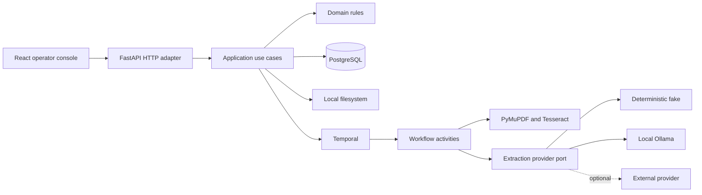

# Architecture

## Purpose

The platform accepts synthetic business documents, processes them asynchronously
and presents validated results for review. It is designed as a local-first
system: a clean default run does not require cloud credentials or a paid AI
provider.

## Components



PostgreSQL is authoritative for documents, processing runs, state transitions,
review decisions and user-facing projections. Temporal stores durable workflow
execution history. Filesystem storage owns document blobs and derived artifacts.
The model provider is never an authority for business state.

## Dependency Direction

```text
adapters -> application -> domain
```

The domain does not import framework, database, workflow, OCR, storage or model
SDK types. The application defines ports only for boundaries that are external,
fallible or plausibly replaceable: repositories, object storage, workflow start,
text extraction, structured extraction and notifications.

Temporal workflows are deterministic orchestration. Database, filesystem, OCR,
clock and model calls happen in Activities, never directly inside workflow code.

## Transaction Ownership

Application use cases own transaction boundaries through a unit of work.
Repositories use its shared session but never commit independently. A use case
must commit explicitly after all related writes succeed; leaving the context
without a commit, including after an exception, rolls the transaction back.
This allows document, processing-run, idempotency and workflow-start records to
be persisted atomically when those capabilities are introduced.

## Repository Structure

The layout in the root README is intentionally a map, not a request to create
empty packages. A vertical slice creates only the directories it needs and
tests mirror the behavior level:

```text
tests/unit/          domain and application rules
tests/integration/   real adapters and infrastructure boundaries
tests/e2e/           API and browser journeys
```

## Current Boundaries

| Boundary | Default implementation | Optional implementation |
| --- | --- | --- |
| Object storage | Local filesystem | S3-compatible adapter |
| Structured extraction | Deterministic fake for CI | Ollama; policy-gated OpenAI comparison |
| Text extraction | PyMuPDF, Tesseract when required | None initially |
| Workflow execution | Temporal development server | Managed/self-hosted Temporal later |

## Related Decisions

- [ADR 0001: Pragmatic Ports and Adapters](decisions/0001-pragmatic-ports-and-adapters.md)
