# Architecture

## Purpose

The platform accepts synthetic business documents and processes them
asynchronously for validation and review. `v0.1` implemented the ingestion
boundary; `v0.7` adds safe terminal-failure reconciliation to bounded
operational telemetry, text extraction, OCR fallback, canonical-text selection,
deterministic classification, invoice extraction, invoice validation,
authenticated review resolution and immutable field-level corrections. It is
designed as a local-first system: a clean default run does not require cloud
credentials or a paid AI provider.

## Implemented Components (`v0.7`)

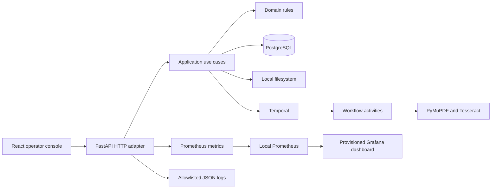

PostgreSQL is authoritative for documents, processing runs, upload idempotency
records, immutable processing outputs and user-facing status projections.
Filesystem storage owns uploaded document blobs. Temporal owns durable workflow
execution history while PostgreSQL remains authoritative for business state.
Liveness reports only that the API process is responding; readiness also checks
PostgreSQL with a lightweight query and does not claim that Temporal workers are
available.

## Local Model Evaluation

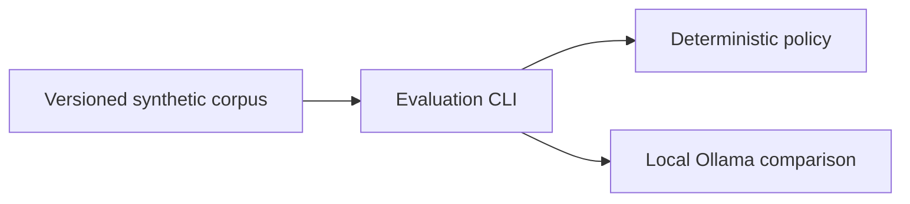

The local Ollama client is an evaluation-only adapter. It is not wired to the
Temporal workflow, cannot persist model output, and is not an authority for
business state. Any future workflow integration requires an explicit policy
gate, a broader corpus and an independently measured improvement.

## Dependency Direction

```text
adapters -> application -> domain
```

The domain does not import framework, database, workflow, OCR, storage or model
SDK types. The application defines ports only for boundaries that are external,
fallible or plausibly replaceable: repositories, object storage, workflow start
and PDF text extraction. The evaluation-only Ollama client deliberately has no
application port until it meets a justified workflow-integration threshold.

Temporal workflows are deterministic orchestration. Database, filesystem, OCR,
clock and model calls happen in Activities, never directly inside workflow code.

## Transaction Ownership

Application use cases own transaction boundaries through a unit of work.
Repositories use its shared session but never commit independently. A use case
must commit explicitly after all related writes succeed; leaving the context
without a commit, including after an exception, rolls the transaction back.
Document, initial processing run, upload-idempotency result and a pending
workflow-start request are persisted atomically. The request uses the processing
run ID to derive a stable future Temporal workflow ID. A dispatcher will start
that workflow only after the transaction commits.

## Durable Workflow Handoff

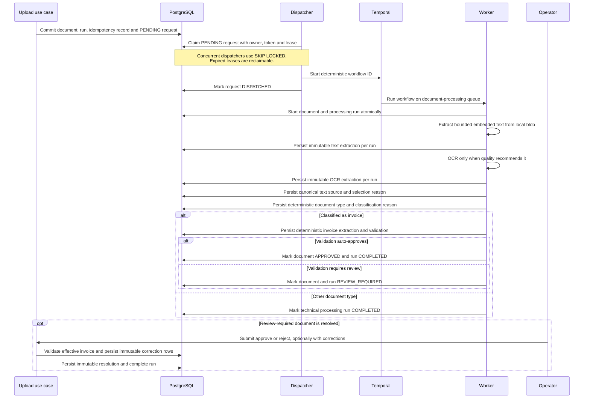

`v0.4` currently implements durable request claiming, application dispatch and
the Temporal activity set for text extraction, OCR, selection, classification,
invoice extraction, validation and lifecycle application. The Temporal adapter starts the stable workflow ID
with an existing-running workflow treated as the same successful handoff. A
separate dispatcher process owns the Temporal connection and polling loop; it
is deliberately independent from the HTTP API so network I/O never occurs
inside the upload transaction. The worker transitions `UPLOADED -> PROCESSING`
and `QUEUED -> RUNNING` atomically, then reads the immutable blob and persists
one bounded PyMuPDF embedded-text extraction for that run. The extraction row
is the idempotency boundary for activity retries: a saved row is reused without
reading or parsing the PDF again. Its persisted quality is a deterministic
`SUFFICIENT` or `OCR_RECOMMENDED` decision based on a configured minimum count
of non-whitespace characters. The next activity reads that decision: it skips
all OCR I/O for `SUFFICIENT`, or persists one immutable Tesseract result for
`OCR_RECOMMENDED`. A saved OCR row is reused on retry.

The final `select-processing-text` activity persists a canonical source for
downstream stages without duplicating document text. `SUFFICIENT` embedded text
is selected directly. Otherwise, the policy selects OCR only when it contains
strictly more non-whitespace characters; ties and lower-quality OCR remain on
the embedded source. The persisted source and reason make this decision
auditable and stable across retries.

The `classify-document` activity reads only the selected persisted text.
Its initial local policy uses versioned keyword sets and word-boundary matching
for invoice, purchase-order and credit-note terms. Exactly one category match
is persisted as that type; no match and multiple matches persist `UNKNOWN` with
distinct reasons. This is a deterministic baseline for later model evaluation,
not a claim of AI accuracy.

For an `INVOICE` classification only, the workflow invokes deterministic
extraction and validation activities. Extraction reads the selected canonical
text and persists only explicitly labelled fields. Validation checks required
fields and positive totals, then persists an immutable `AUTO_APPROVE` or
`REVIEW_REQUIRED` decision. Applying that decision updates the document and run
in one transaction: auto-approval yields `APPROVED` and `COMPLETED`; incomplete
data yields `REVIEW_REQUIRED` for both. `PURCHASE_ORDER`, `CREDIT_NOTE` and
`UNKNOWN` classifications skip invoice stages and use `complete-processing-run`.
All activity outputs are immutable and keyed by processing run, which makes
retries safe. The status API and console expose safe structured values and
reason codes, never source text or storage paths.

An operator may approve a review-required invoice with a non-empty set of typed
field corrections. The application applies that set only in memory to validate
the effective invoice, then persists correction rows and the review resolution
in one transaction. The original extraction is never overwritten. A rejected
review cannot carry corrections, and an approval without corrections remains
valid only when the originally extracted invoice is complete.

The operator console derives its processing timeline from the same persisted
metadata exposed by the status endpoint. It does not query Temporal directly,
and it does not receive document text or blob paths. A stage is shown as
completed only after its immutable output is persisted; the next stages remain
in progress or pending until their own metadata appears.

The local OCR adapter rasterizes pages with PyMuPDF and invokes the configured
Tesseract executable one page at a time. It applies the accepted page limit,
the same bounded text limit, a configurable DPI and a per-page timeout. Serial
execution is intentional: the worker should bound CPU and memory consumption
before configurable parallelism is introduced with operational evidence.

Status queries use a dedicated read-model port. Its PostgreSQL adapter joins the
document with its most recently queued processing run and returns only the fields
required by the public API; it does not load aggregates or open a write transaction.
The same adapter exposes paginated `ACTIVE`, `REVIEW` and `FAILED` work queues,
selecting each document's latest run and returning metadata only. Queue listing
is bounded to 100 rows per request and ordered by document acceptance time.
When processing output is available, the same snapshot includes extraction
counts, quality decisions, selection, classification, structured invoice fields
and validation reason codes. It deliberately excludes extracted text, original
blobs and internal storage paths.

The React upload feature keeps temporary file selection in local component state
and delegates the remote mutation lifecycle to TanStack Query. One client-generated
idempotency key is retained across retries of the same selection and replaced when
the selected document changes. Transport types come from the versioned OpenAPI
contract; unexpected technical error details are not rendered to operators.
The work-queue view queries one bounded `ACTIVE`, `REVIEW` or `FAILED` page at a
time, refreshes it periodically or on request, and opens the existing persisted
status view for a selected document. The selected document ID is reflected in
the `documentId` query parameter, so a detail can be reopened directly and
browser history restores the previous selection. Review and recovery actions
continue to use their existing endpoints rather than mutating queue rows
directly.
The result panel polls the same persisted status snapshot and renders the
available processing stages without receiving document text.

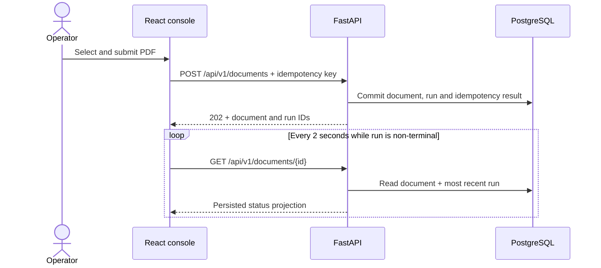

TanStack Query pauses ordinary interval refetching when the page is in the
background. The feature stops polling when automated processing reaches
`COMPLETED`, `FAILED`, `CANCELLED` or `REVIEW_REQUIRED`; retry states remain
observable.

## Terminal Workflow Failures

Temporal activity retries are bounded. When an activity reaches a terminal
`ActivityError`, the workflow first invokes a dedicated recording activity.
That transaction stores only a bounded failing stage and failure code, then
transitions the processing run and document to `FAILED`. The workflow rethrows
the error afterwards, so Temporal history truthfully remains failed rather
than presenting a recovered completion.

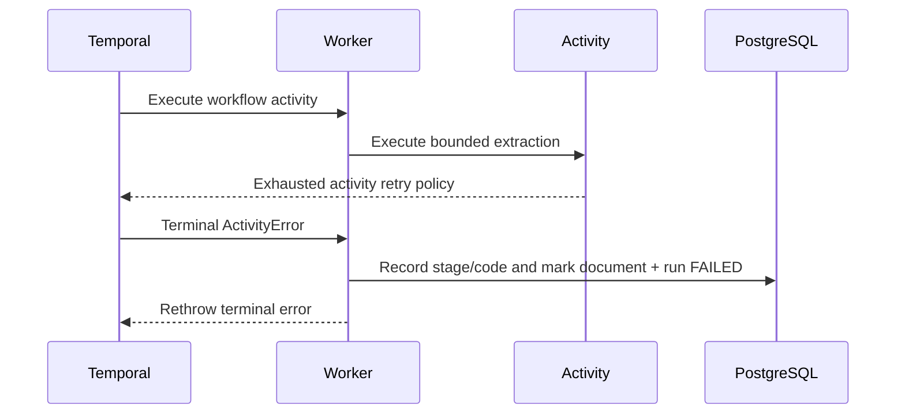

Raw exception messages, stack traces, document text and storage paths remain
out of the business-state model and public status projection. The status API
and console expose only the bounded stage and code for the current run. The authenticated
reprocessing flow creates a separate queued run that references the failed run;
it does not restart or mutate the failure evidence.

## Domain Lifecycles

The domain model reserves the following document lifecycle for processing and
review. Current worker execution transitions `UPLOADED` to `PROCESSING`:

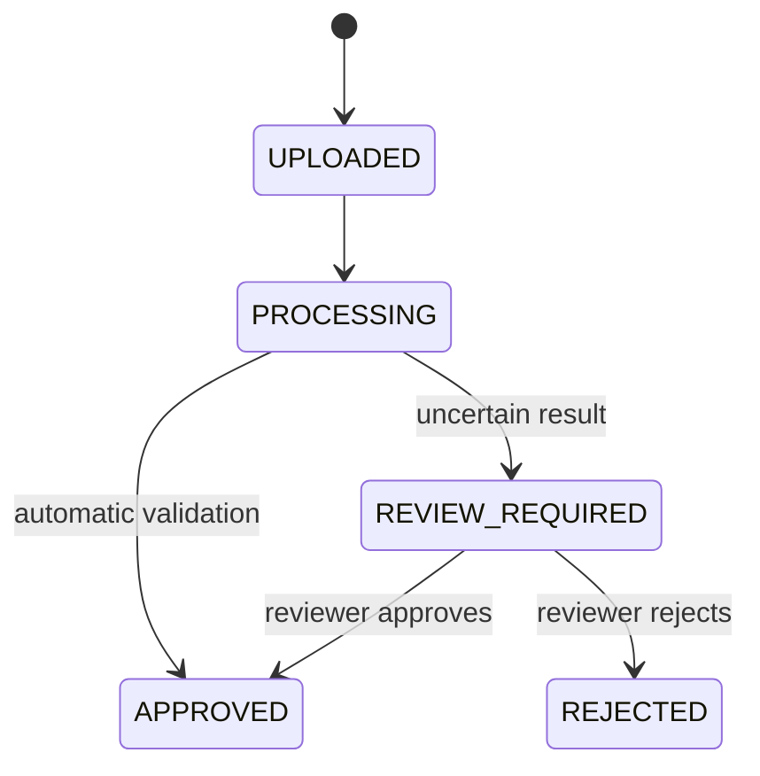

Processing-run status describes one durable technical execution. Failures and
retries belong here rather than in the document lifecycle. Current worker
execution transitions a `QUEUED` run to `RUNNING`:

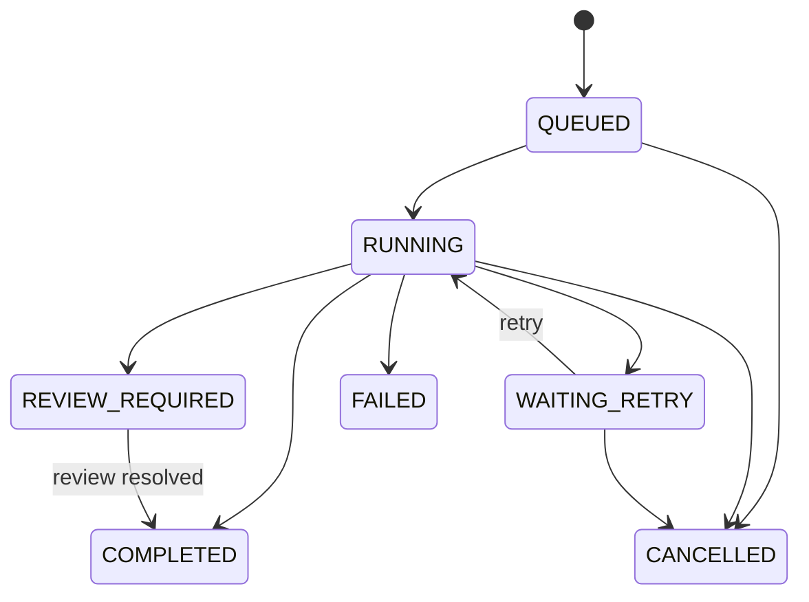

Individual processing stages will have their own persisted lifecycle when stage
execution is introduced; it is not simulated by the current domain model.

## Persistence Model

One document can have multiple processing runs. A controlled reprocessing
operation creates a replacement run that points at its immutable predecessor
without overwriting execution history. The operation itself is persisted as an
audit record with its operator, reason and idempotency key:

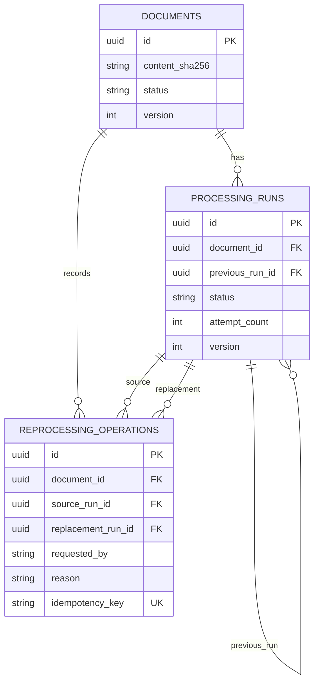

Deleting a document as part of an explicit retention operation cascades to its
processing runs and reprocessing operations. Ordinary processing never deletes
or mutates completed evidence. PostgreSQL also permits at most one active run
per document, so concurrent replacement workflows cannot compete for the same
document.

## Local Blob Lifecycle

The default storage adapter copies a request-owned staged file to a private
temporary file in bounded chunks while enforcing the configured size limit and
calculating SHA-256. It synchronizes the complete file before atomically
publishing it under a content-derived key:

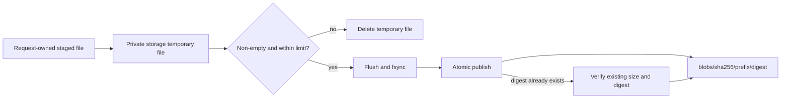

Callers cannot choose filesystem paths, and original filenames never become
storage keys. Files use mode `0600`; generated directories use mode `0700`.
Concurrent uploads of identical bytes converge on one immutable blob. A
pre-existing object that does not match its content-derived key is treated as
an integrity conflict rather than overwritten. Temporary files are removed on
success and handled failures; crash-orphan reconciliation is a later operational
capability.

A read-only local inventory lists canonical published blob metadata and counts
`.upload` files in `temporary` and `incoming` separately. It caps scanned
directory entries and marks partial results as truncated; it does not follow
symlinks, compare against database references or delete files.
The separate `blob_audit` command compares older published entries against
PostgreSQL in a bounded batch and reports only aggregate potential-orphan
counts. It cannot authorize deletion because an upload may race the audit.

## PDF Acceptance Boundary

The upload boundary treats the declared media type as untrusted. A seekable,
size-bounded temporary file is inspected with PyMuPDF before domain registration:

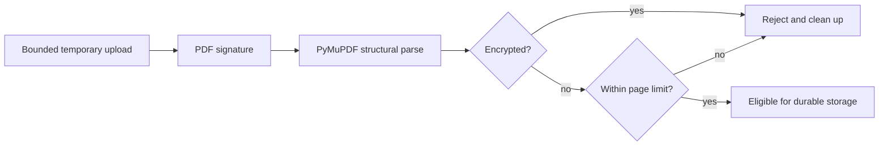

The inspector returns only trusted structural metadata such as page count. Text
extraction and OCR are later processing stages and do not belong to upload
acceptance. The current local parser boundary is covered with generated synthetic
PDFs; hostile-file isolation and malware scanning remain explicit later controls.

The application acceptance order is metadata validation, byte-limit check, PDF
inspection, immutable blob publication and finally idempotent database
registration. Invalid PDFs therefore never enter durable blob storage. The
filesystem cannot participate in the PostgreSQL transaction: a database failure
after publication may leave an unreferenced content-addressed blob. Immediate
deletion would be unsafe under deduplication and concurrent uploads, so an
age-bounded reference-aware reconciler will remove such orphans.

## Upload Idempotency

An upload idempotency key identifies one logical client request, not one physical
blob. The server stores a deterministic fingerprint of the accepted filename,
media type and content digest with the eventual document and processing-run IDs.
Reusing the key with the same fingerprint returns the original acceptance result;
reusing it for different request data is a conflict. Physical blobs remain
deduplicated independently by their content digest.

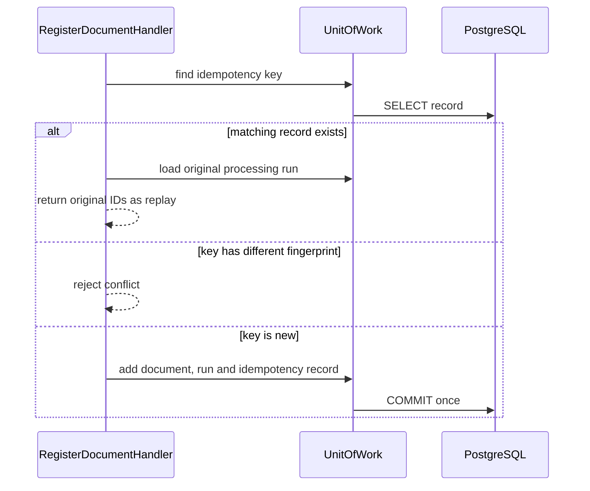


## Repository Structure

The layout in the root README is intentionally a map, not a request to create
empty packages. A vertical slice creates only the directories it needs and
tests mirror the behavior level:

```text
tests/unit/          domain and application rules
tests/integration/   real adapters and infrastructure boundaries
tests/e2e/           API and browser journeys
```

## Current Boundaries

| Boundary | Current implementation | Planned extension |
| --- | --- | --- |
| Object storage | Local filesystem | S3-compatible adapter |
| Invoice extraction | Deterministic extraction, validation and immutable review corrections | Evaluation-only Ollama comparison; workflow use requires a policy gate |
| Text extraction | Embedded/OCR extraction and persisted canonical source selection | OCR quality calibration and language policy |
| Document classification | Deterministic canonical-text keyword policy | Evaluated local model policy |
| Workflow execution | Temporal development server with local worker | Managed/self-hosted Temporal later |
| Review authentication | Configured local static bearer token | Enterprise identity and authorization provider |
| Operational telemetry | Prometheus metrics, provisioned local Grafana dashboard and allowlisted JSON logs with bounded HTTP correlation | Production monitoring, access policy and alerting |

## Related Decisions

- [ADR 0001: Pragmatic Ports and Adapters](decisions/0001-pragmatic-ports-and-adapters.md)
- [ADR 0002: Preserve Operator Corrections Separately from Extraction](decisions/0002-preserve-operator-corrections-separately.md)
- [ADR 0003: Keep Local Models Evaluation-Only Until a Policy Gate Is Met](decisions/0003-keep-local-models-evaluation-only.md)
- [ADR 0004: Expose Low-Cardinality Prometheus Metrics](decisions/0004-expose-low-cardinality-prometheus-metrics.md)
- [ADR 0005: Use Bounded HTTP Correlation Identifiers](decisions/0005-use-bounded-http-correlation-identifiers.md)
- [ADR 0006: Emit Allowlisted JSON Application Logs](decisions/0006-emit-allowlisted-json-application-logs.md)
- [ADR 0007: Create Immutable Processing-Run Lineage for Controlled Reprocessing](decisions/0007-create-immutable-reprocessing-lineage.md)
- [ADR 0008: Record Safe Terminal Workflow Failure Evidence](decisions/0008-record-safe-terminal-workflow-failure-evidence.md)
