# Architecture

## Purpose

The platform accepts synthetic business documents and will process them
asynchronously for validation and review. `v0.1` implements the ingestion
boundary only: it durably accepts eligible PDFs and creates a queued processing
run. It is designed as a local-first system: a clean default run does not
require cloud credentials or a paid AI provider.

## Implemented Components (`v0.1`)

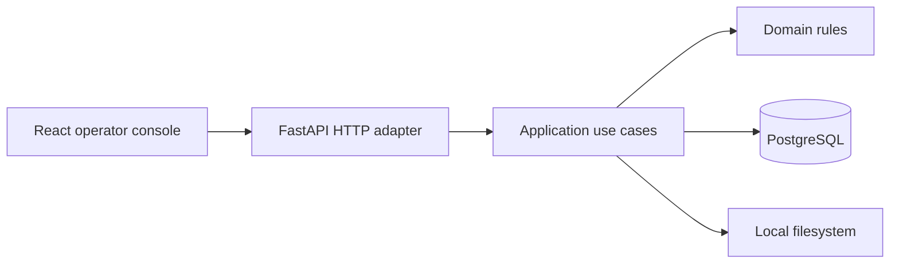

PostgreSQL is authoritative for documents, processing runs, upload idempotency
records and user-facing status projections. Filesystem storage owns uploaded
document blobs. The current processing run is intentionally left in `QUEUED`
until a worker is introduced.

## Target Components

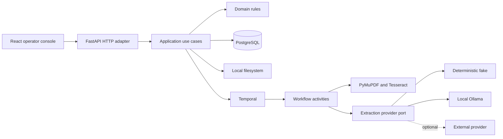

Temporal, OCR, structured extraction and review components are planned
extensions. When introduced, PostgreSQL will remain authoritative for business
state, Temporal will own durable workflow execution history, and the model
provider will never be an authority for business state.

## Dependency Direction

```text
adapters -> application -> domain
```

The domain does not import framework, database, workflow, OCR, storage or model
SDK types. The application defines ports only for boundaries that are external,
fallible or plausibly replaceable: repositories, object storage, workflow start,
text extraction, structured extraction and notifications.

When introduced, Temporal workflows will be deterministic orchestration.
Database, filesystem, OCR, clock and model calls will happen in Activities,
never directly inside workflow code.

## Transaction Ownership

Application use cases own transaction boundaries through a unit of work.
Repositories use its shared session but never commit independently. A use case
must commit explicitly after all related writes succeed; leaving the context
without a commit, including after an exception, rolls the transaction back.
Document, initial processing run, upload-idempotency result and a pending
workflow-start request are persisted atomically. The request uses the processing
run ID to derive a stable future Temporal workflow ID. A dispatcher will start
that workflow only after the transaction commits.

## Durable Workflow Handoff

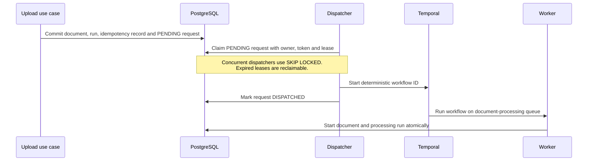

`v0.2` currently implements the durable request, PostgreSQL claim and
application dispatch steps. The Temporal adapter starts the stable workflow ID
with an existing-running workflow treated as the same successful handoff. A
separate dispatcher process owns the Temporal connection and polling loop; it
is deliberately independent from the HTTP API so network I/O never occurs
inside the upload transaction. The processing worker currently performs only
the first durable activity: `UPLOADED -> PROCESSING` for the document and
`QUEUED -> RUNNING` for its run. PDF extraction is introduced separately.

Status queries use a dedicated read-model port. Its PostgreSQL adapter joins the
document with its most recently queued processing run and returns only the fields
required by the public API; it does not load aggregates or open a write transaction.

The React upload feature keeps temporary file selection in local component state
and delegates the remote mutation lifecycle to TanStack Query. One client-generated
idempotency key is retained across retries of the same selection and replaced when
the selected document changes. Transport types come from the versioned OpenAPI
contract; unexpected technical error details are not rendered to operators.

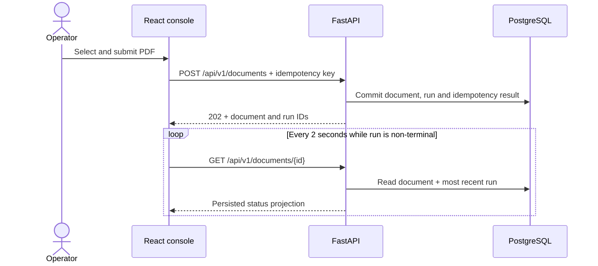

TanStack Query pauses ordinary interval refetching when the page is in the
background. The feature stops polling when the processing run reaches
`COMPLETED`, `FAILED` or `CANCELLED`; review and retry states remain observable.

## Domain Lifecycles

The domain model reserves the following document lifecycle for future processing
and review. `v0.1` currently persists `UPLOADED` only:

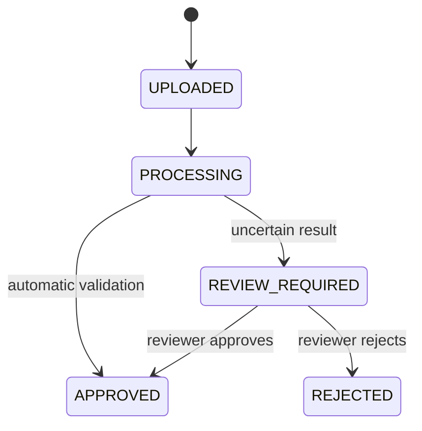

Processing-run status describes one durable technical execution. Failures and
retries belong here rather than in the document lifecycle. `v0.1` currently
creates a `QUEUED` run only:

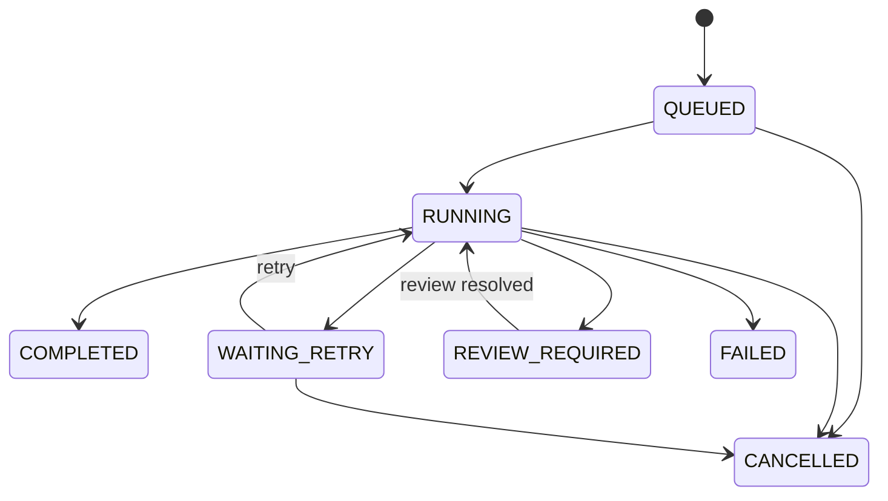

Individual processing stages will have their own persisted lifecycle when stage
execution is introduced; it is not simulated by the current domain model.

## Persistence Model

One document can have multiple processing runs, allowing an explicit future
reprocessing operation without overwriting execution history:

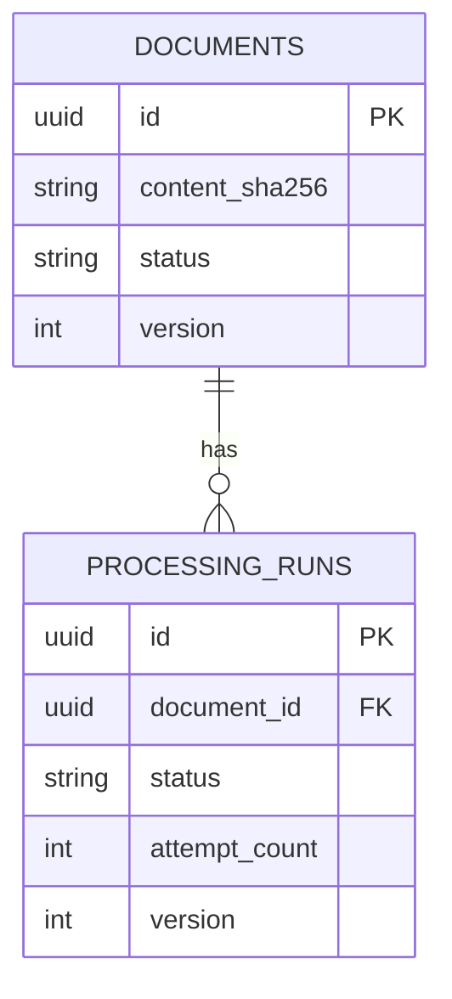

Deleting a document as part of an explicit retention operation cascades to its
processing runs. Ordinary processing never deletes either record.

## Local Blob Lifecycle

The default storage adapter copies a request-owned staged file to a private
temporary file in bounded chunks while enforcing the configured size limit and
calculating SHA-256. It synchronizes the complete file before atomically
publishing it under a content-derived key:

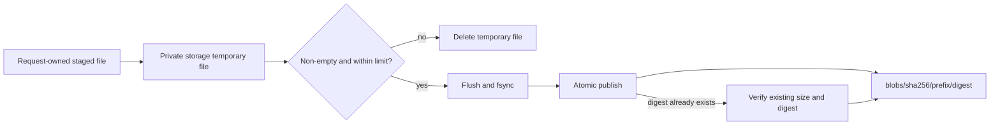

Callers cannot choose filesystem paths, and original filenames never become
storage keys. Files use mode `0600`; generated directories use mode `0700`.
Concurrent uploads of identical bytes converge on one immutable blob. A
pre-existing object that does not match its content-derived key is treated as
an integrity conflict rather than overwritten. Temporary files are removed on
success and handled failures; crash-orphan reconciliation is a later operational
capability.

## PDF Acceptance Boundary

The upload boundary treats the declared media type as untrusted. A seekable,
size-bounded temporary file is inspected with PyMuPDF before domain registration:

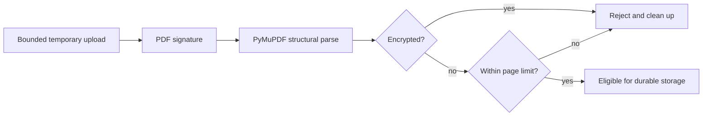

The inspector returns only trusted structural metadata such as page count. Text
extraction and OCR are later processing stages and do not belong to upload
acceptance. The current local parser boundary is covered with generated synthetic
PDFs; hostile-file isolation and malware scanning remain explicit later controls.

The application acceptance order is metadata validation, byte-limit check, PDF
inspection, immutable blob publication and finally idempotent database
registration. Invalid PDFs therefore never enter durable blob storage. The
filesystem cannot participate in the PostgreSQL transaction: a database failure
after publication may leave an unreferenced content-addressed blob. Immediate
deletion would be unsafe under deduplication and concurrent uploads, so an
age-bounded reference-aware reconciler will remove such orphans.

## Upload Idempotency

An upload idempotency key identifies one logical client request, not one physical
blob. The server stores a deterministic fingerprint of the accepted filename,
media type and content digest with the eventual document and processing-run IDs.
Reusing the key with the same fingerprint returns the original acceptance result;
reusing it for different request data is a conflict. Physical blobs remain
deduplicated independently by their content digest.

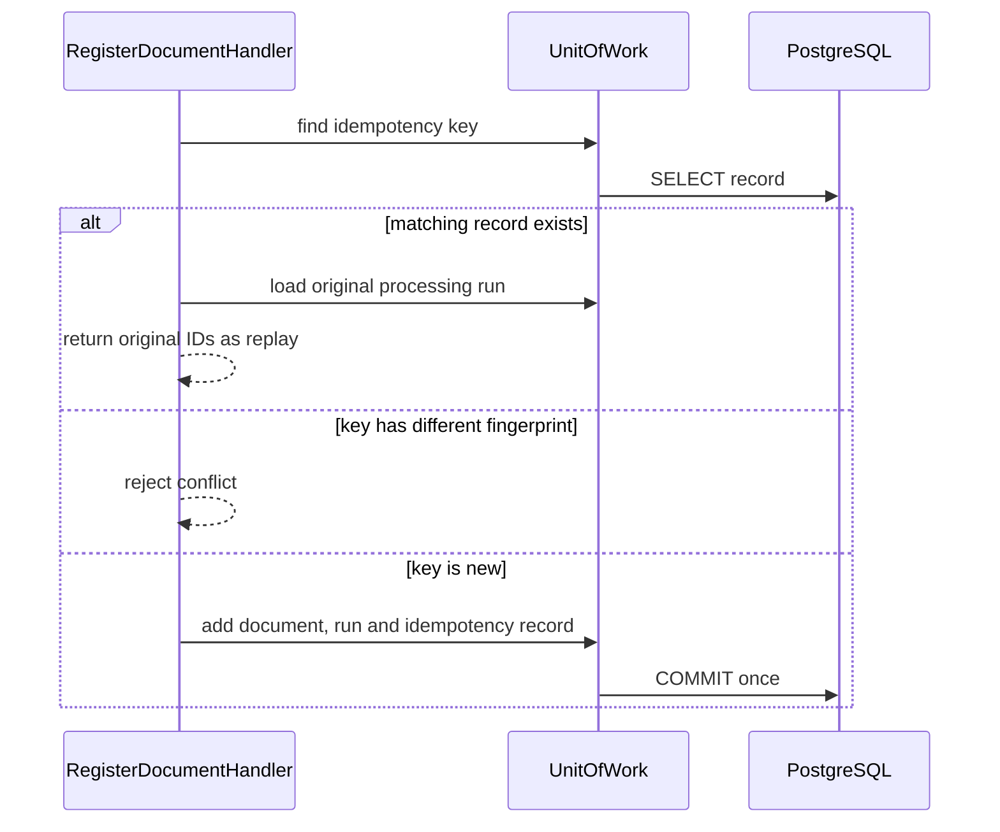

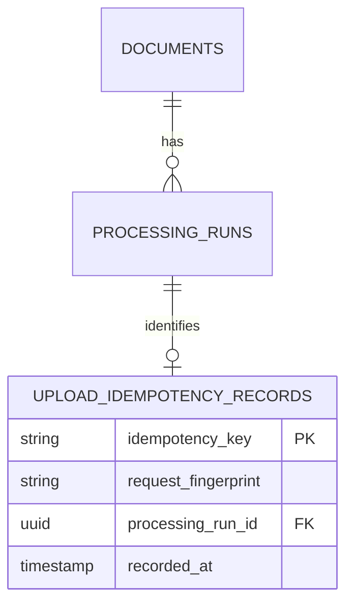

## Repository Structure

The layout in the root README is intentionally a map, not a request to create
empty packages. A vertical slice creates only the directories it needs and
tests mirror the behavior level:

```text
tests/unit/          domain and application rules
tests/integration/   real adapters and infrastructure boundaries
tests/e2e/           API and browser journeys
```

## Current Boundaries

| Boundary | `v0.1` implementation | Planned extension |
| --- | --- | --- |
| Object storage | Local filesystem | S3-compatible adapter |
| Structured extraction | Not implemented | Deterministic fake; Ollama; policy-gated OpenAI comparison |
| Text extraction | PyMuPDF structural validation | Text extraction and Tesseract OCR |
| Workflow execution | Queued PostgreSQL processing run | Temporal development server; managed/self-hosted Temporal later |

## Related Decisions

- [ADR 0001: Pragmatic Ports and Adapters](decisions/0001-pragmatic-ports-and-adapters.md)
