# Architecture

## Purpose

The platform accepts synthetic business documents and processes them
asynchronously for validation and review. Uploads are bounded, idempotent and
stored by content hash. A dispatcher hands committed start requests to a
Temporal workflow that extracts embedded text, falls back to OCR, selects the
canonical text, classifies the document and validates invoices
deterministically. Operators resolve review-required invoices with typed
corrections that record their provenance; values taken from a model proposal
are checked against the persisted proposal. An optional local model can propose
invoice fields without becoming authoritative. Terminal failures record
bounded evidence, and a failed run can be replaced through controlled
reprocessing.

It is designed as a local-first system: a clean default run does not require
cloud credentials or a paid AI provider. The [product overview](product-overview.md)
summarizes the same scope for a first reading.

## Runtime System Map

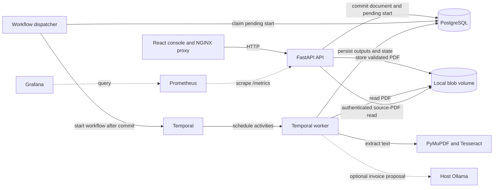

PostgreSQL is authoritative for documents, processing runs, upload idempotency
records, immutable processing outputs and user-facing status projections.
Filesystem storage owns uploaded document blobs. Temporal owns durable workflow
execution history while PostgreSQL remains authoritative for business state.
The dispatcher starts workflows from committed PostgreSQL requests; the API
does not start them inside the upload transaction. The console reads business
state through the API, not directly from Temporal or PostgreSQL. Dashed edges
mark optional model and observability integrations. The invoice workflow invokes the
local proposal adapter only after deterministic completion and only when the
worker's Ollama setting is enabled.

Liveness reports only that the API process is responding; readiness also checks
PostgreSQL with a lightweight query and does not claim that Temporal workers are
available.

## Local Model Evaluation

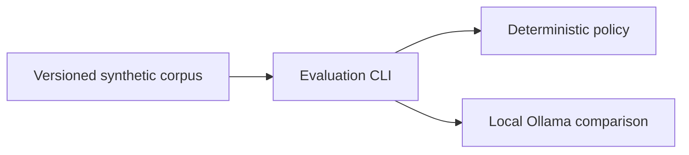

The evaluation CLI remains an isolated comparison. Separately, the invoice
workflow now schedules advisory proposal generation after deterministic
validation has completed. The activity exits immediately when Ollama is
disabled (the default). When enabled, it allows one concurrent model call per
worker by default, with at most two attempts, 150 seconds per attempt and five
minutes total. Terminal provider errors are recorded as safe codes in an
immutable table without changing document status. Proposal and failure writes
lock the same processing-run row and reject the opposite outcome. Proposals and
failures are exposed separately through the document-status API. The local model is never an
authority for deterministic extraction or review decisions. Old workflow
histories retain their command sequence through the
`advisory-invoice-proposal-v1` Temporal patch. See
[ADR 0003](decisions/0003-keep-local-models-advisory.md).

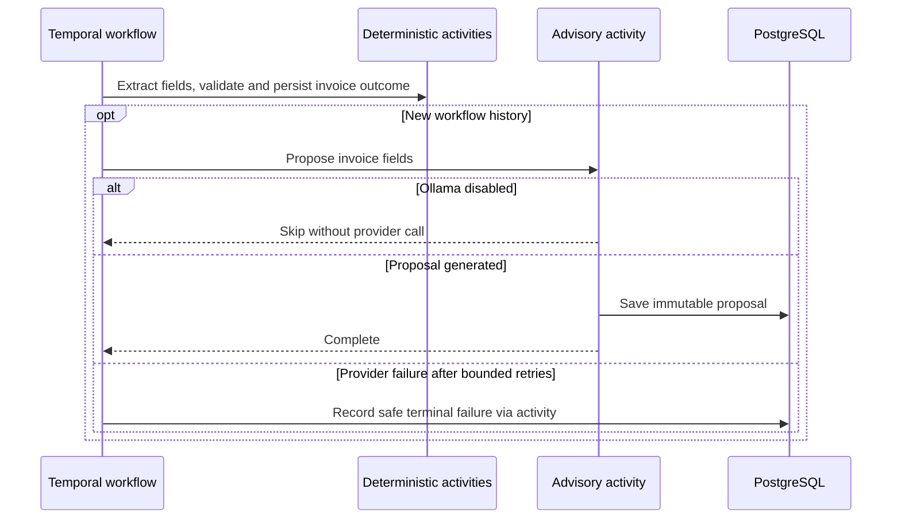

## Dependency Direction

```text
adapters -> application -> domain
```

The domain does not import framework, database, workflow, OCR, storage or model
SDK types. The application defines ports for external, fallible or replaceable
boundaries, including repositories, object storage, workflow start, PDF text
extraction and the local model proposal generator. Model proposals remain
advisory, outside the authoritative extraction and review result.

Temporal workflows are deterministic orchestration. Database, filesystem, OCR,
clock and model calls happen in Activities, never directly inside workflow code.
The replay test in `tests/unit/workflows/test_process_business_document_replay.py`
checks saved, synthetic `v0.9.0` histories for the invoice and other-document
branches against the current workflow. It detects incompatible changes to the
recorded command sequence without starting Temporal in CI. Fixture generation
is isolated in `scripts/record-temporal-replay-fixtures.py`; regenerate only
when intentionally establishing a new compatibility baseline, never from
production histories. Replay does not prove that activity implementations or
external integrations remain backward compatible.

## Transaction Ownership

Application use cases own transaction boundaries through a unit of work.
Repositories use its shared session but never commit independently. A use case
must commit explicitly after all related writes succeed; leaving the context
without a commit, including after an exception, rolls the transaction back.
Document, initial processing run, upload-idempotency result and a pending
workflow-start request are persisted atomically. The request uses the processing
run ID to derive a stable Temporal workflow ID. A dispatcher starts
that workflow only after the transaction commits.

## Durable Workflow Handoff


The implementation has durable request claiming, application dispatch and
Temporal activities for text extraction, OCR, selection, classification,
invoice extraction, validation and lifecycle application. The Temporal adapter
starts the stable workflow ID, treating an already-running workflow as the
same successful handoff. A separate dispatcher process owns the Temporal
connection and polling loop. It is independent from the HTTP API, so network
I/O never occurs inside the upload transaction. The worker transitions
`UPLOADED -> PROCESSING` and `QUEUED -> RUNNING` atomically, then reads the
immutable blob and persists one bounded PyMuPDF embedded-text extraction for
that run. The extraction row
is the idempotency boundary for activity retries: a saved row is reused without
reading or parsing the PDF again. Its persisted quality is a deterministic
`SUFFICIENT` or `OCR_RECOMMENDED` decision based on a configured minimum count
of non-whitespace characters. The next activity reads that decision: it skips
all OCR I/O for `SUFFICIENT`, or persists one immutable Tesseract result for
`OCR_RECOMMENDED`. A saved OCR row is reused on retry.

The final `select-processing-text` activity persists a canonical source for
downstream stages without duplicating document text. `SUFFICIENT` embedded text
is selected directly. Otherwise, the policy selects OCR only when it contains
strictly more non-whitespace characters; ties and lower-quality OCR remain on
the embedded source. The persisted source and reason make this decision
auditable and stable across retries.

The `classify-document` activity reads only the selected persisted text.
Its initial local policy uses versioned keyword sets and word-boundary matching
for invoice, purchase-order and credit-note terms. Exactly one category match
is persisted as that type; no match and multiple matches persist `UNKNOWN` with
distinct reasons. This is a deterministic baseline for later model evaluation,
not a claim of AI accuracy.

For an `INVOICE` classification only, the workflow invokes deterministic
extraction and validation activities. Extraction reads the selected canonical
text and persists only explicitly labelled fields. Validation checks required
fields and positive totals, then persists an immutable `AUTO_APPROVE` or
`REVIEW_REQUIRED` decision. Applying that decision updates the document and run
in one transaction: auto-approval yields `APPROVED` and `COMPLETED`; incomplete
data yields `REVIEW_REQUIRED` for both. `PURCHASE_ORDER`, `CREDIT_NOTE` and
`UNKNOWN` classifications skip invoice stages and use `complete-processing-run`.
That activity marks the document `UNSUPPORTED` and completes the processing run
in one database transaction. The saved classification distinguishes unknown
input from a recognized type without structured extraction support. The
operator console lists these documents in a separate queue and explains the
outcome. Unsupported documents are not retryable until a new processing
capability is implemented. The migration backfills old completed non-invoice
runs whose document was left in `PROCESSING`. All activity outputs are
immutable and keyed by processing run, which makes retries safe. The status API
and console expose safe structured values and reason codes, never source text
or storage paths. A separate bearer-protected local endpoint returns the source
PDF for review. The review panel fetches it on demand with the operator token
held in memory and displays it through a temporary browser object URL. Closing
the preview or unmounting the component revokes that URL; unmounting also aborts
an in-flight request. PDF responses use `no-store`, `nosniff` and a generic
inline filename. The shared local token can retrieve any stored document.
The preview includes a new-tab link to that same temporary URL; the link is
removed on close. Its document remains subject to the browser's native PDF
viewer rather than a custom PDF.js implementation.
Source-loading feedback distinguishes rejected credentials, denied access,
unavailable documents, server errors and fetch connectivity failures. It uses
fixed messages without exposing response details or storage paths. A retry
uses the current operator token and preserves the review draft. HTTP status
codes remain available even when an error response has no usable problem JSON.

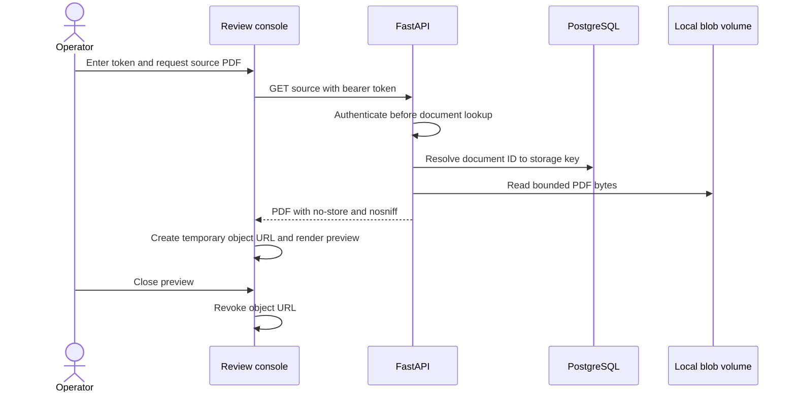

An operator may approve a review-required invoice with a non-empty set of typed
field corrections. The application applies that set only in memory to validate
the effective invoice, then persists correction rows and the review resolution
in one transaction. The original extraction is never overwritten. A rejected
review cannot carry corrections, and an approval without corrections remains
valid only when the originally extracted invoice is complete.

The console may copy an individual advisory AI proposal into the correction
form, but the operator must still submit the approval. Each correction records
whether it was entered manually or selected from the proposal. The API verifies
AI-sourced values against the persisted proposal before accepting them; the
browser cannot assert that provenance by itself.

Each editable field shows an AI suggestion when it differs from the original
extraction, with a textual adoption control. The form identifies manual and
AI-sourced corrections, shows the original value after a change and can restore
it. Restoring a missing original value clears the correction. Editing an
adopted suggestion changes its source to manual; restoring removes its source.
Adoption and restoration return focus to the input. These controls inherit the
review fieldset's disabled state while saving; proposals never approve a
document automatically.

The Documents page keeps review drafts in React memory, keyed by document,
processing run and extraction timestamp. Switching or hiding a document,
queue navigation and browser history preserve field values, correction sources
and review notes. A separate Documents-page provider holds one operator token
in React memory for PDF access, review and reprocessing. The Operator access
panel owns the credential input; action panels link back to it. Document
selection, browser history and successful actions preserve this token. Clearing
it closes the PDF preview and aborts an in-flight source request without removing
review drafts. Leaving or reloading Documents destroys the token. It is excluded
from drafts, browser storage and URLs. Isolated action panels without this
provider retain their local credential input and clear it after success.
No draft data is written to browser storage.
A successful review clears its draft; a failed request preserves it. Invoice
fields and proposal adoption are disabled while the decision is being saved.
When any draft has unsaved changes, the page registers a native browser
`beforeunload` warning for reloads and full-page navigation, including System
Map. The browser controls whether it displays that warning; drafts are not
durable across page reloads or browser termination.

Document details place the review workspace and available recovery actions
before supplementary information. Persisted validation issues appear beside
the document guidance. The source PDF and editable fields share a row when the
review container is wide enough; the review note follows the fields.
Processing history, technical metadata, and results/AI evidence use native
disclosures. History starts expanded while processing or AI execution is active;
the review form remains outside these disclosures so opening them preserves
the working draft.

Approval guidance uses the current run's persisted evidence. An `APPROVE`
review resolution identifies operator approval; otherwise, an `AUTO_APPROVE`
validation decision identifies automatic approval only when no review resolution
exists. An approved status alone, including an original `REVIEW_REQUIRED`
validation without a resolution, does not identify the source of approval.
The console explicitly reports that the origin is unavailable in these cases.

Processing-result empty states use the deterministic run status, independently
of optional AI execution. Queued, running and retrying runs may show pending
results. Completed, failed, cancelled and review-required runs show missing
results as unrecorded. Null output and output with no recorded stages share one
empty message. Persisted partial results remain visible, and known non-invoice
types retain not-applicable labels for invoice stages. Missing OCR metadata is
labeled unrecorded because its absence alone does not establish whether OCR
was skipped or attempted.

The operator console derives its processing timeline from the same persisted
metadata exposed by the status endpoint. It does not query Temporal directly,
and it does not receive document text or blob paths. A deterministic stage is shown as
completed only after its immutable output is persisted; the next stages remain
in progress or pending until their own metadata appears.
The advisory AI stage follows deterministic completion or review handoff. It
renders recorded execution as running, completed, failed or disabled; non-invoice
documents skip it. A missing execution record remains unrecorded, including
historical outcomes. A stale running marker is shown without a live spinner,
using the same six-minute polling boundary as the comparison panel. Completing
AI execution does not assert proposal validity or document approval; provider
failure does not change the deterministic document outcome. Proposal and failure
details appear in the comparison panel only after persistence.

The separate System Map page is static architecture documentation. Component
and journey-step selections retain focus and update concise polite status
announcements. Full detail panels are not live regions. Each selected component
or step offers an adjacent native anchor to its focusable detail heading.
Outcome selection resets the journey to its first step while keeping focus on
the outcome control. Its document
journey illustrates possible approval, review and failure/reprocessing paths
using these persisted-state semantics, including the optional advisory invoice
proposal after deterministic completion. It links to the implementation and
does not read a run, report live component health or reconstruct Temporal history.

The local OCR adapter rasterizes pages with PyMuPDF and invokes the configured
Tesseract executable one page at a time. It applies the accepted page limit,
the same bounded text limit, a configurable DPI and a per-page timeout. Serial
execution is intentional: the worker should bound CPU and memory consumption
before configurable parallelism is introduced with operational evidence.

Status queries use a dedicated read-model port. Its PostgreSQL adapter joins the
document with its most recently queued processing run and returns only the fields
required by the public API; it does not load aggregates or open a write transaction.
The same adapter exposes paginated `ACTIVE`, `REVIEW`, `FAILED` and `UNSUPPORTED` work queues,
selecting each document's latest run and returning metadata only. Queue listing
is bounded to 100 rows per request and ordered by document acceptance time.
When processing output is available, the same snapshot includes extraction
counts, quality decisions, selection, classification, structured invoice fields
and validation reason codes. It deliberately excludes extracted text, original
blobs and internal storage paths.
Optional AI proposal and terminal provider-failure records are joined by the
current processing-run ID and returned separately from deterministic output.
The read model includes only structured proposed fields, issue codes and model
provenance; it excludes source text, prompts and raw provider responses. This
local demo does not authenticate status reads, so only synthetic documents
should be uploaded.
The operator console renders recorded advisory fields beside the original
rule-based extraction. An operator can explicitly adopt a field as a correction;
the API checks that it matches the persisted proposal before resolving review.
Terminal deterministic processing no longer stops periodic polling while an
explicit AI execution is `RUNNING`. Polling remains every two seconds, with a
six-minute window from the recorded AI start; older or unusable start timestamps
pause periodic updates and display a diagnostic message. Active deterministic
processing still polls normally. A newly finalized invoice with neither an
execution nor an outcome gets a 30-second grace period, measured from its
persisted run status-change timestamp, to cover the gap before AI activity entry.
Unknown historical records do not poll forever. Disabled/completed/failed AI
outcomes stop polling once deterministic processing is terminal. Manual refresh
remains available. These are browser query limits, not cancellation or changes
to the worker's five-minute retry budget.

The comparison panel displays explicit execution state, provider failures and
proposed field validity separately. A valid proposal means all five fields were
returned in values the application can parse; it does not establish that they
match the PDF or approve the invoice. A missing state is shown as not recorded
for invoices, never as disabled. Legacy proposals/failures remain visible even
without an execution record. Unknown non-invoice documents do not get an invoice
AI panel or a start grace period. Feedback uses live status messages without
moving focus. Credentials precede the source/field workspace in DOM order;
the review note and decision controls follow the invoice fields. At a panel
content width of at least 48rem, a container query puts source PDF and correction
controls side by side. Narrower panels offer "Invoice fields" and "Source PDF"
view buttons, with fields selected initially. The inactive panel stays mounted
but is hidden from display, keyboard navigation and assistive technologies.
Switching views preserves drafts, credentials and an already loaded PDF object
URL without another source request. The same controls, correction provenance and
approval requests are used in both layouts. Storybook covers source availability, loading
and safe failure using the existing synthetic invoice, not a real API token.

### Advisory Execution Contract

The domain now defines a separate `AiInvoiceProposalExecution` lifecycle.
Migration `20260929_01` and a PostgreSQL repository now support storing this
lifecycle in `ai_invoice_proposal_executions`, with one row per processing run.
The worker records it when entering the proposal activity, before acquiring
the per-worker model slot. The status API now exposes its safe metadata under
`current_run.ai_execution`: `status`, `status_changed_at`, `started_at` and
`finished_at`. It is joined on the current run, never taken from a previous
run. The console renders it in the comparison panel and uses it to control
periodic status polling. The migration does not backfill legacy runs.

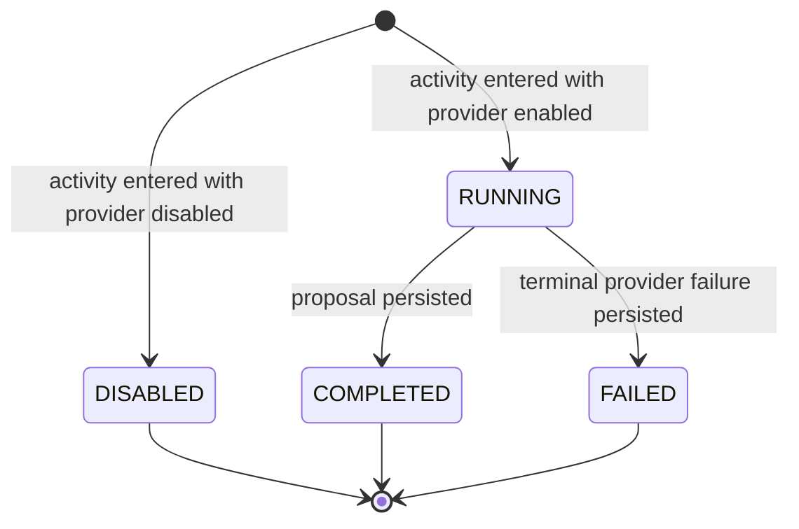

`RUNNING` includes waiting for the local model slot and bounded retries, not
only model inference. `COMPLETED` means a proposal was recorded, even if its
field validation is `INVALID`; it does not mean document approval. `FAILED`
is a terminal provider outcome, not a change to the document status. Start and
finish times are timezone-aware and cannot move backwards; terminal records
cannot transition again. A missing execution record must not be interpreted as
`DISABLED`: the API returns `null` for older histories and runs that have not
recorded entry into the activity. The field is nullable and optional in the
OpenAPI schema for additive client compatibility; current status responses
include it even when null. No execution status is inferred from the document
status or from proposal/failure records. Only synthetic metadata is exposed,
not prompts, source text, storage paths or credentials.
Database constraints enforce timestamp/status coherence and cascade deletion
with the owning processing run. Repository creation accepts only `DISABLED` or
`RUNNING`; completion updates only a matching `RUNNING` row with the same start
time. Concurrent terminal updates cannot overwrite one another. The repository
uses the caller's transaction. The proposal handler commits `COMPLETED` with
the proposal, and the terminal-failure handler commits `FAILED` with the safe
failure evidence; either both changes commit or neither does. Cross-table
outcome coherence is not enforced by this table alone.

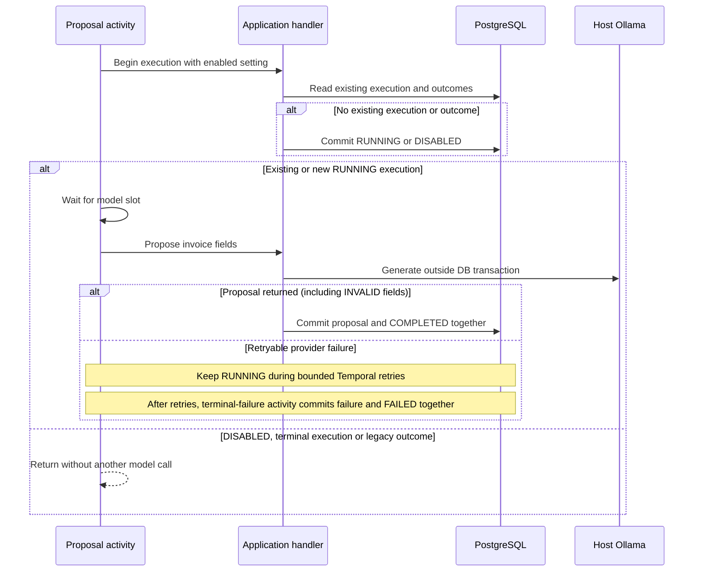

Retries preserve the original execution start and enablement decision, including
after worker configuration changes. Existing proposals/failures without an
execution record remain historical outcomes and are not re-generated. Outcomes
from older activities can still be recorded without an execution row; this also
covers a timeout before the proposal activity records its start. Unexpected
technical failures are not mislabelled as provider failures and may leave a
`RUNNING` marker for diagnosis: this record is not a Temporal liveness check.
No workflow command sequence changed; these writes occur inside existing
Activities, preserving the existing patch/replay contract.

The React upload feature keeps temporary file selection in local component state
and delegates the remote mutation lifecycle to TanStack Query. One client-generated
idempotency key is retained across retries of the same selection and replaced when
the selected document changes. Transport types come from the versioned OpenAPI
contract; unexpected technical error details are not rendered to operators.
The upload controls form a compact row above the work queues and stack on narrow
screens. The picker displays PDF limits or the selected file name and size;
selection, removal and submission remain separate actions.
The work-queue view queries one bounded `ACTIVE`, `REVIEW`, `FAILED` or `UNSUPPORTED` page at a
time, refreshes it periodically or on request, and opens the existing persisted
status view for a selected document. The selected document ID is reflected in
the `documentId` query parameter, so a detail can be reopened directly and
browser history restores the previous selection. Review and recovery actions
continue to use their existing endpoints rather than mutating queue rows
directly.
The Documents page owns the selection and renders a single detail outside the
upload form and queue rows. Successful uploads select the accepted document and
refresh the work queues; selecting a queue item updates that same detail. Queue
filtering, pagination and refresh do not remount the selected detail. Selecting a
different document creates a new detail instance so local state cannot leak
between documents. Source-PDF preview remains on demand.
The selected document view leads with the filename and separate document and
processing statuses, followed by a status-specific explanation. Review-required
documents link directly to the review form. Page count, attempts, run IDs and
failure codes are grouped under a native expandable technical-details section.
The result panel polls the same persisted status snapshot and renders the
available processing stages without receiving document text.

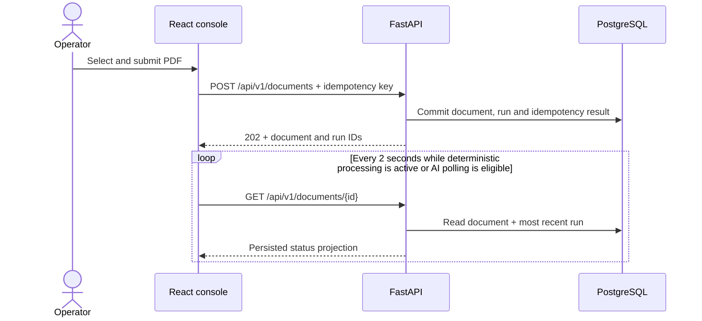

TanStack Query pauses ordinary interval refetching when the page is in the
background. Active deterministic processing continues polling. After the run
reaches `COMPLETED`, `FAILED`, `CANCELLED` or `REVIEW_REQUIRED`, periodic updates
continue only within the recorded AI execution window or the invoice AI-start
grace period described in the [advisory execution contract](#advisory-execution-contract).
Manual refresh remains available after those windows expire.

## Terminal Workflow Failures

Temporal activity retries are bounded. When an activity reaches a terminal
`ActivityError`, the workflow first invokes a dedicated recording activity.
That transaction stores only a bounded failing stage and failure code, then
transitions the processing run and document to `FAILED`. The workflow rethrows
the error afterwards, so Temporal history truthfully remains failed rather
than presenting a recovered completion.

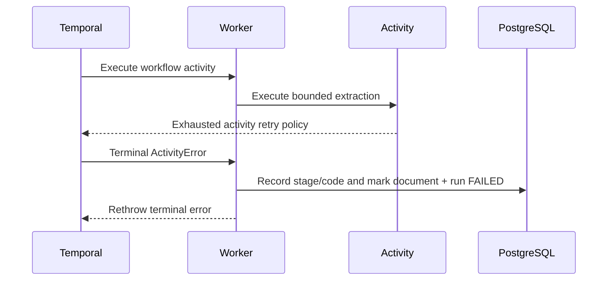

Raw exception messages, stack traces, document text and storage paths remain
out of the business-state model and public status projection. The status API
and console expose only the bounded stage and code for the current run. The authenticated
reprocessing flow creates a separate queued run that references the failed run;
it does not restart or mutate the failure evidence.

## Domain Lifecycles

The document lifecycle allowed by the domain model
(`src/document_platform/domain/documents/document.py`):

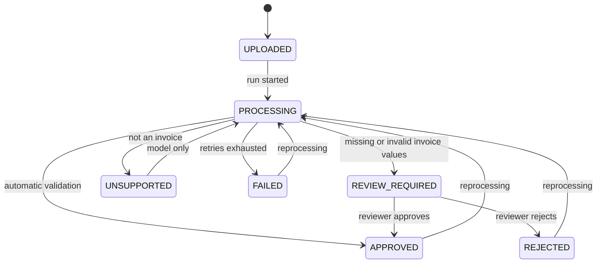

The reprocessing command reopens `APPROVED`, `REJECTED` and `FAILED`
documents. It refuses `UNSUPPORTED` and `REVIEW_REQUIRED` documents, so the
`UNSUPPORTED` transition is not reachable through the application today.

Processing-run status describes one durable technical execution. Failures and
retries belong here rather than in the document lifecycle. The transitions
allowed by the domain model
(`src/document_platform/domain/processing/processing_run.py`):

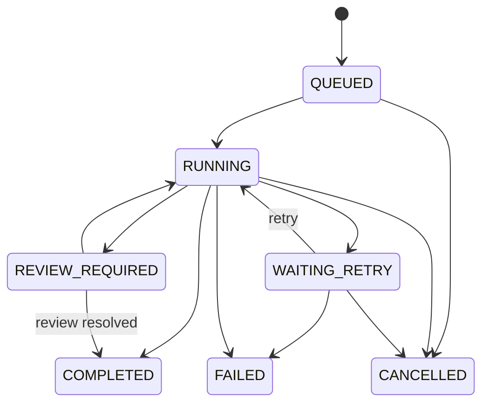

Individual processing stages will have their own persisted lifecycle when stage
execution is introduced; it is not simulated by the current domain model.

## Persistence Model

One document can have multiple processing runs. A controlled reprocessing
operation creates a replacement run that points at its immutable predecessor
without overwriting execution history. The operation itself is persisted as an
audit record with its operator, reason and idempotency key:

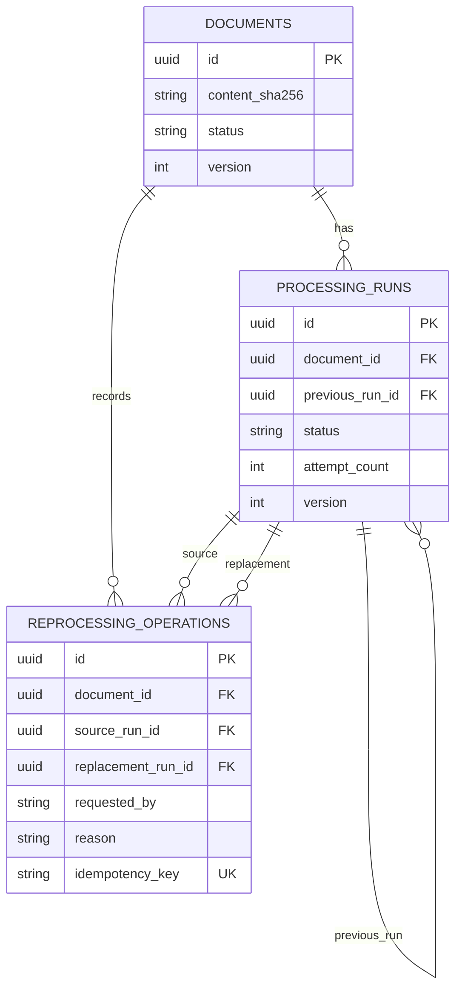

Deleting a document as part of an explicit retention operation cascades to its
processing runs and reprocessing operations. Ordinary processing never deletes
or mutates completed evidence. PostgreSQL also permits at most one active run
per document, so concurrent replacement workflows cannot compete for the same
document.

## Local Blob Lifecycle

The default storage adapter copies a request-owned staged file to a private
temporary file in bounded chunks while enforcing the configured size limit and
calculating SHA-256. It synchronizes the complete file before atomically
publishing it under a content-derived key:

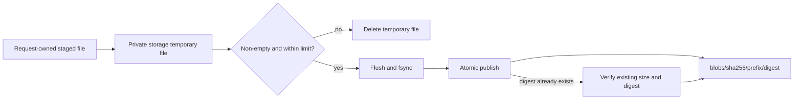

Callers cannot choose filesystem paths, and original filenames never become
storage keys. Files use mode `0600`; generated directories use mode `0700`.
Concurrent uploads of identical bytes converge on one immutable blob. A
pre-existing object that does not match its content-derived key is treated as
an integrity conflict rather than overwritten. Temporary files are removed on
success and handled failures; crash-orphan reconciliation is a later operational
capability. Current auditing can report old staged files but does not remove
them.

A read-only local inventory lists canonical published blob metadata and counts
`.upload` files in `temporary` and `incoming` separately. It caps scanned
directory entries and marks partial results as truncated; it does not follow
symlinks, compare against database references or delete files.
The separate `blob_audit` command compares older published entries against
PostgreSQL in a bounded batch and reports only aggregate potential-orphan
counts. It also separates recent staged uploads from those older than the same
age threshold, without exposing their names. Neither observation can authorize
deletion because an upload may race the audit.

## PDF Acceptance Boundary

The upload boundary treats the declared media type as untrusted. A seekable,
size-bounded temporary file is inspected with PyMuPDF before domain registration:

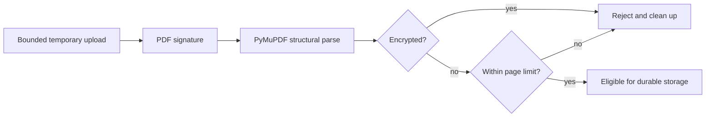

The inspector returns only trusted structural metadata such as page count. Text
extraction and OCR are later processing stages and do not belong to upload
acceptance. The current local parser boundary is covered with generated synthetic
PDFs; hostile-file isolation and malware scanning remain explicit later controls.

The application acceptance order is metadata validation, byte-limit check, PDF
inspection, immutable blob publication and finally idempotent database
registration. Invalid PDFs therefore never enter durable blob storage. The
filesystem cannot participate in the PostgreSQL transaction: a database failure
after publication may leave an unreferenced content-addressed blob. Immediate
deletion would be unsafe under deduplication and concurrent uploads, so an
age-bounded audit reports possible orphans only. Physical deletion remains
disabled until uploads and cleanup share a database-backed per-blob lock.

## Upload Idempotency

An upload idempotency key identifies one logical client request, not one physical
blob. The server stores a deterministic fingerprint of the accepted filename,
media type and content digest with the eventual document and processing-run IDs.
Reusing the key with the same fingerprint returns the original acceptance result;
reusing it for different request data is a conflict. Physical blobs remain
deduplicated independently by their content digest.

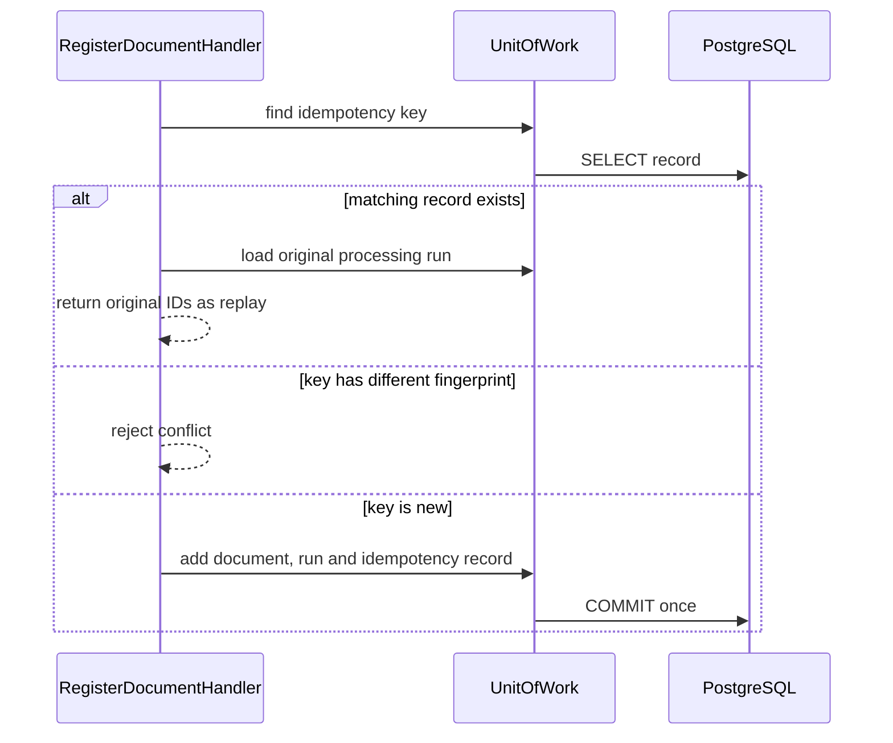

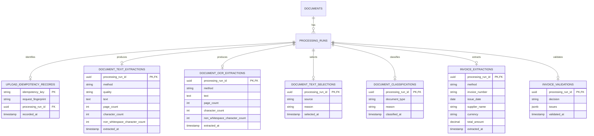

## Repository Structure

The layout in the root README is intentionally a map, not a request to create
empty packages. A vertical slice creates only the directories it needs and
tests mirror the behavior level:

```text
tests/unit/          domain and application rules
tests/integration/   real adapters and infrastructure boundaries
tests/e2e/           API and browser journeys
```

## Current Boundaries

| Boundary | Current implementation | Planned extension |
| --- | --- | --- |
| Object storage | Local filesystem | S3-compatible adapter |
| Original document access | Separate review-token-protected PDF endpoint and on-demand console preview with in-memory token and revoked object URL | Production identity, authorization and document isolation |
| Invoice extraction | Deterministic extraction and validation, opt-in advisory proposals, API/console comparison, explicit proposal adoption and immutable correction provenance | Broader corpus and model-quality evaluation |
| Text extraction | Embedded/OCR extraction and persisted canonical source selection | OCR quality calibration and language policy |
| Document classification | Deterministic canonical-text keyword policy | Evaluated local model policy |
| Workflow execution | Self-hosted `temporalio/auto-setup` server with a dedicated PostgreSQL database and a local worker | Managed or production self-hosted Temporal later |
| Application containers | Multi-stage non-root Python image; static React build served by unprivileged NGINX with `/api` proxy; opt-in Compose `app` and local `processing` profiles with migration and Temporal readiness gates, shared document volume | Production deployment configuration outside local Compose |
| Review authentication | Configured local static bearer token | Enterprise identity and authorization provider |
| Operational telemetry | Prometheus metrics, provisioned local Grafana dashboard and allowlisted JSON logs with bounded HTTP correlation | Production monitoring, access policy and alerting |

## Related Decisions

The [local security and limitations](security-and-limitations.md) document
records the demo trust boundary and controls not yet implemented.

- [ADR 0001: Pragmatic Ports and Adapters](decisions/0001-pragmatic-ports-and-adapters.md)
- [ADR 0002: Preserve Operator Corrections Separately from Extraction](decisions/0002-preserve-operator-corrections-separately.md)
- [ADR 0003: Keep Local Model Output Advisory](decisions/0003-keep-local-models-advisory.md)
- [ADR 0004: Expose Low-Cardinality Prometheus Metrics](decisions/0004-expose-low-cardinality-prometheus-metrics.md)
- [ADR 0005: Use Bounded HTTP Correlation Identifiers](decisions/0005-use-bounded-http-correlation-identifiers.md)
- [ADR 0006: Emit Allowlisted JSON Application Logs](decisions/0006-emit-allowlisted-json-application-logs.md)
- [ADR 0007: Create Immutable Processing-Run Lineage for Controlled Reprocessing](decisions/0007-create-immutable-reprocessing-lineage.md)
- [ADR 0008: Record Safe Terminal Workflow Failure Evidence](decisions/0008-record-safe-terminal-workflow-failure-evidence.md)
- [ADR 0009: Use Explicit, Safe Document Retention](decisions/0009-use-explicit-safe-document-retention.md)
- [ADR 0010: Record Unsupported Document Outcomes](decisions/0010-record-unsupported-document-outcomes.md)
- [ADR 0011: Protect Local Source-Document Preview](decisions/0011-protect-local-source-document-preview.md)
- [ADR 0012: Use Temporal for Durable Document-Processing Orchestration](decisions/0012-use-temporal-for-durable-document-processing.md)
