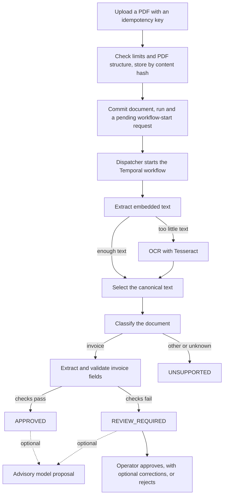
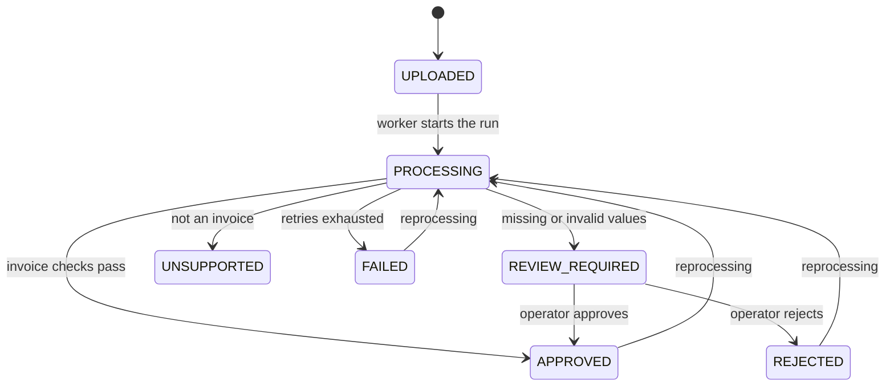

# Product Overview

## Purpose

AI Document Processing Platform accepts business documents as PDFs, extracts
their text, classifies them and turns invoices into structured, validated data.
Invoices that pass the deterministic checks are approved automatically; those
with missing or invalid values go to a human reviewer. An optional local model
can propose invoice fields, but it never decides.

It is a local-first demonstration on synthetic documents. A clean default run
needs no cloud credentials and no paid AI provider. It is not a service for
confidential data or untrusted users; see
[security and limitations](security-and-limitations.md).

## Problem

Accounts teams receive documents that need the same work every time: open the
PDF, recognize the document type, copy the invoice number, date, supplier,
currency and total, and check that the values make sense. Four things go wrong:

- **Scanned documents have no text.** An image-only PDF needs OCR before it can
  be read.
- **Data is missing or invalid.** A document without an issue date, or with an
  unknown currency, must not be approved automatically.
- **Processing stops halfway.** A worker, the database or a tool can fail
  between two steps. The document must neither disappear nor stay "processing"
  forever.
- **Models are confidently wrong.** A language model can infer a value that the
  document does not contain and present it as certain.

## Design Principle: the Model Advises, People Decide

Deterministic extraction, validation and human review are authoritative. A
local Ollama model, disabled by default, may produce a separate immutable
proposal after the deterministic outcome exists. It never overwrites extracted
values and never approves a document.

An operator can adopt a proposed value as a correction. The correction records
whether it was entered manually or taken from the proposal, and the API checks
an AI-sourced value against the persisted proposal; the browser cannot assert
that provenance. Extracted PDF and OCR text is stored internally in PostgreSQL
so later stages and retries can reuse it. Model calls do not store an additional
copy of that text, the assembled prompts or raw model responses. Document text,
prompts and raw responses are excluded from application logs and the status
and queue APIs.

The first recorded benchmark matched four of eight synthetic invoices exactly
and inferred a value from a sentence that was not an invoice. That is evidence
for an advisory role, not a measure of real-world accuracy. See
[ADR 0003](decisions/0003-keep-local-models-advisory.md) and the
[evaluation notes](evaluation.md).

## Actors

| Actor | Responsibility |
| --- | --- |
| Operator | Uploads documents, follows the work queues and resolves review-required invoices. |
| Platform engineer | Runs the services, investigates failed runs and requests controlled reprocessing. |
| Local model (optional) | Proposes invoice fields. Advisory only. |

## End-to-end Flow

The upload does not start the workflow. It commits a workflow-start request in
the same transaction as the document, and a separate dispatcher hands it to
Temporal with a stable workflow ID. A failure between the two systems therefore
leaves a durable request that the dispatcher can retry, rather than losing the
handoff after accepting the document. Processing waits while Temporal or a
worker is unavailable. See [Durable Workflow Handoff](architecture.md#durable-workflow-handoff).

## Document Outcomes

| Status | Meaning |
| --- | --- |
| `APPROVED` | The invoice passed the deterministic checks, or an operator approved it after review. |
| `REVIEW_REQUIRED` | The invoice is incomplete or invalid and needs an operator. |
| `UNSUPPORTED` | Not an invoice, or not recognized. Recognized types and unknown input keep distinct reasons ([ADR 0010](decisions/0010-record-unsupported-document-outcomes.md)). |
| `FAILED` | A processing stage failed after retries or with a non-retryable error. Only a bounded stage and failure code are recorded ([ADR 0008](decisions/0008-record-safe-terminal-workflow-failure-evidence.md)). |
| `REJECTED` | An operator rejected a review-required invoice. |

Each document also has processing runs, which describe one technical execution.
Document status answers "what happened to the business document"; run status
answers "what happened to this execution". Reprocessing creates a new run that
references its predecessor and never rewrites earlier evidence
([ADR 0007](decisions/0007-create-immutable-reprocessing-lineage.md)).

## Reliability Model

- Document, first processing run, upload-idempotency record and workflow-start
  request commit atomically.
- An upload idempotency key identifies one logical request; the same key with
  different request data is a conflict.
- Blobs are stored by SHA-256 and published atomically; identical bytes share
  one blob.
- The dispatcher claims requests with `SKIP LOCKED` and a lease, and starts
  workflows with a deterministic ID that cannot be started twice.
- Workflow code is deterministic orchestration. Database, filesystem, OCR and
  model calls run in Activities.
- Every Activity output is immutable and keyed by processing run, so a retried
  Activity reuses saved work.
- Retries are bounded per stage. A terminal failure is recorded in PostgreSQL
  before the error is rethrown, so Temporal history and business state agree.
- Workflow changes that alter the recorded command sequence use Temporal
  patches and are checked by a replay test.

Why Temporal is used is recorded in
[ADR 0012](decisions/0012-use-temporal-for-durable-document-processing.md).

## Capability Status

| Capability | Status |
| --- | --- |
| Bounded, idempotent PDF upload with structural validation and content-addressed storage | Implemented |
| Durable workflow handoff through committed start requests and a dispatcher | Implemented |
| Embedded-text extraction, OCR fallback and canonical-text selection | Implemented |
| Deterministic document classification | Implemented |
| Invoice extraction and validation | Implemented, invoices only |
| Purchase orders and credit notes | Recognized and recorded as `UNSUPPORTED`; structured extraction not implemented |
| Human review with typed corrections and verified provenance | Implemented |
| Advisory local-model invoice proposals | Implemented; opt-in and disabled by default |
| Source-PDF preview during review | Implemented behind a shared local bearer token |
| Controlled reprocessing with immutable run lineage | Implemented |
| Safe terminal failure evidence | Implemented |
| Database retention | Implemented as an operator command, dry-run by default |
| Physical blob deletion | Not implemented; blob auditing reports potential orphans only |
| Prometheus metrics, allowlisted JSON logs, HTTP correlation and a local Grafana dashboard | Implemented |
| Distributed tracing across the workflow | Not implemented; HTTP correlation does not cross into workflows |
| S3-compatible storage | Planned |
| Notifications | Planned |
| Aggregate evaluation dashboard | Not implemented; corpus reports are command-line output |
| Production authentication, authorization and tenant isolation | Not implemented |
| Malware scanning and parser isolation | Not implemented |

## Non-goals

- Production processing of confidential or untrusted documents.
- Automatic approval based on model output or confidence.
- General document editing; corrections are a separate, immutable record
  ([ADR 0002](decisions/0002-preserve-operator-corrections-separately.md)).
- Real-world extraction-accuracy claims from the synthetic corpus.
- Throughput or latency claims; the system has not been load-tested.

## Further Reading

- [Architecture](architecture.md)
- [Security and limitations](security-and-limitations.md)
- [Evaluation](evaluation.md)
- [Architecture decisions](decisions/)
- [Release notes](releases/)
